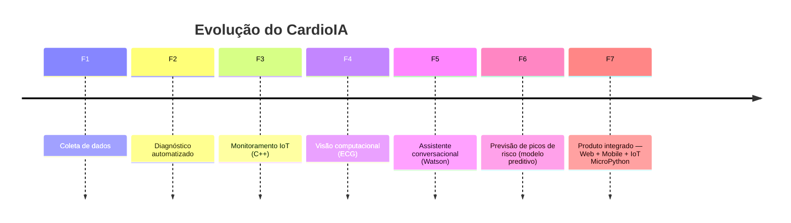
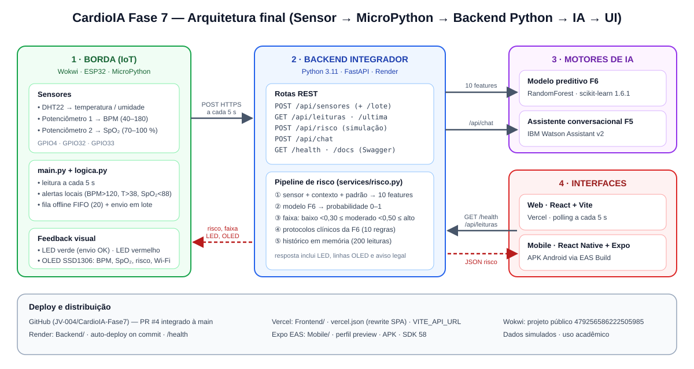
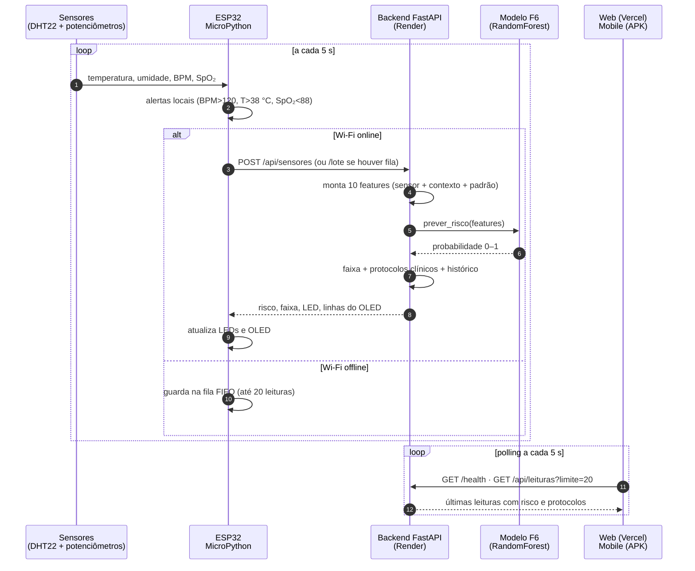
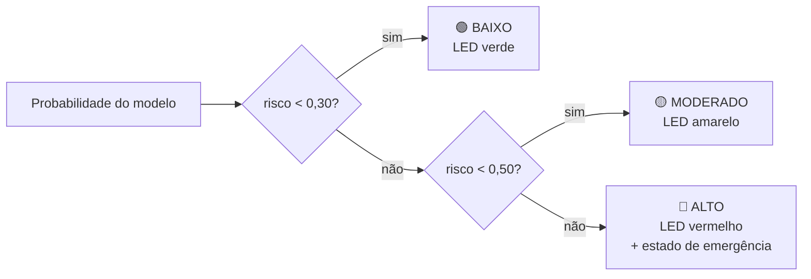
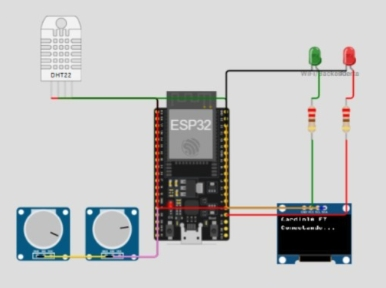
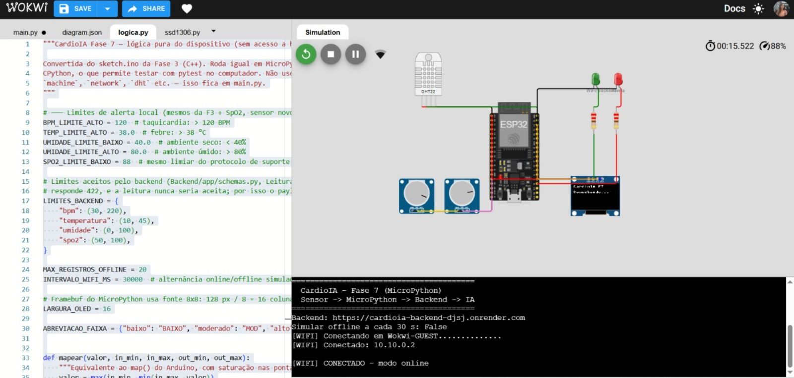
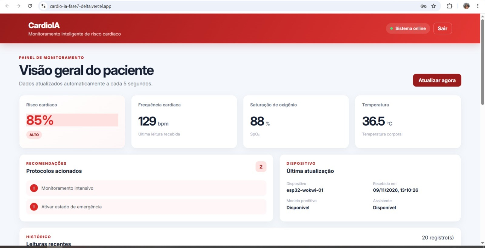
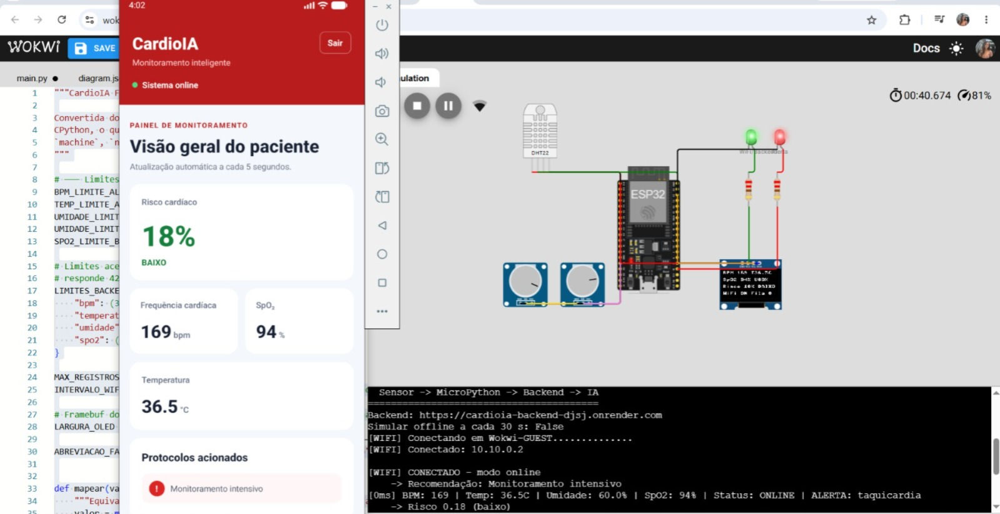
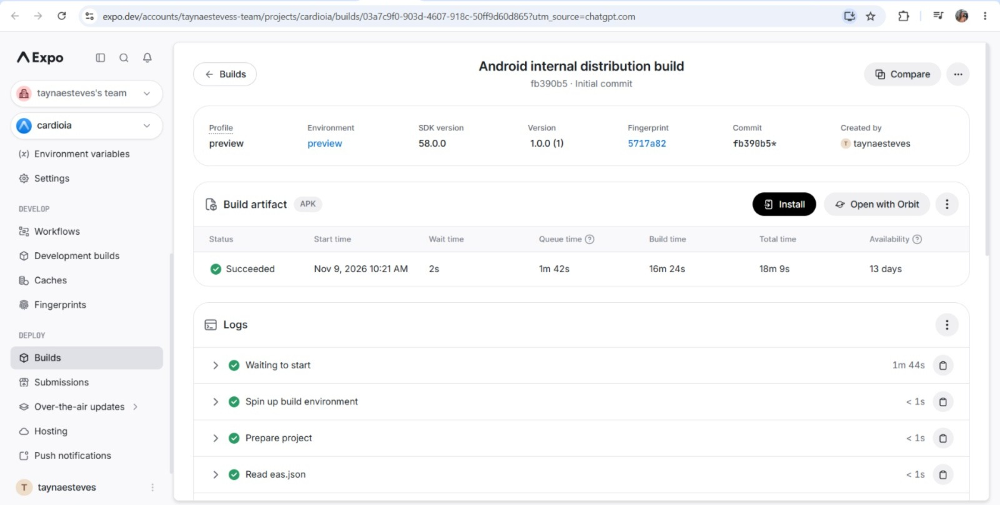

<p align="center">
  <a href="https://www.fiap.com.br/">
    
  </a>
</p>


<div align="center">

# ❤️ CardioIA — Fase 7

### Coração Sob Controle: Previsão de Crises com IA

**MVP final: deploy Web + Mobile + IoT em MicroPython**

FIAP — Inteligência Artificial · 2026

[](https://cardio-ia-fase7-delta.vercel.app)
[](https://cardioia-backend-djsj.onrender.com/docs)
[-3DDC84?logo=android&logoColor=white)](https://expo.dev/accounts/taynaesteves-team/projects/cardioia/builds/03a7c9f0-903d-4607-918c-50ff9d60d865)
[](https://wokwi.com/projects/479256586222505985)


</div>

> [!IMPORTANT]
> **Projeto acadêmico com dados simulados.** O CardioIA não faz diagnóstico clínico e não substitui avaliação médica. Toda resposta clínica da API traz o campo `aviso` com essa ressalva.

---

## 📑 Sumário

1. [Acesso rápido para o avaliador](#-1-acesso-rápido-para-o-avaliador)
2. [Contexto do projeto](#-2-contexto-do-projeto)
3. [Arquitetura final](#-3-arquitetura-final)
4. [Fluxo de dados ponta a ponta](#-4-fluxo-de-dados-ponta-a-ponta)
5. [Componentes da solução](#-5-componentes-da-solução)
6. [Deploy e distribuição (Parte 1)](#-6-deploy-e-distribuição-parte-1)
7. [Integração do ecossistema (Parte 2)](#-7-integração-do-ecossistema-parte-2)
8. [Testes e evidências](#-8-testes-e-evidências)
9. [Como executar e reproduzir](#-9-como-executar-e-reproduzir)
10. [Estrutura do repositório](#-10-estrutura-do-repositório)
11. [Mapa de atendimento aos critérios de avaliação](#-11-mapa-de-atendimento-aos-critérios-de-avaliação)
12. [Limitações conhecidas e pendências](#-12-limitações-conhecidas-e-pendências)
13. [Problemas encontrados e soluções](#-13-problemas-encontrados-e-soluções)
14. [Equipe](#-14-equipe)

---

## 🚀 1. Acesso rápido para o avaliador

| Entregável | Link | Observação |
|---|---|---|
| 🌐 **Aplicação Web (Vercel)** | https://cardio-ia-fase7-delta.vercel.app | Login de demonstração: `admin@cardioia.com` / `CardioIA2026` |
| ⚙️ **Backend (Render)** | https://cardioia-backend-djsj.onrender.com | Plano gratuito: **abra o `/health` primeiro** e aguarde ~60 s se estiver hibernando |
| 🩺 **Health check** | https://cardioia-backend-djsj.onrender.com/health | Retorna `status`, `modelo_carregado` e `watson_configurado` |
| 📘 **Swagger (documentação interativa)** | https://cardioia-backend-djsj.onrender.com/docs | Permite testar todas as rotas no navegador |
| 📱 **Build Android (Expo EAS)** | [Build `03a7c9f0…`](https://expo.dev/accounts/taynaesteves-team/projects/cardioia/builds/03a7c9f0-903d-4607-918c-50ff9d60d865) | Status `Succeeded`, perfil `preview`, SDK 58 |
| 📦 **APK para instalação** | [Baixar APK](https://expo.dev/artifacts/eas/7tdOKuCQB1dAh2fsRM4aLjKU9222JSKtFk8syvfqzsg.apk) | Link temporário do Expo (disponível por 13 dias a partir de 09/11/2026) |
| 🔌 **Simulação IoT (Wokwi)** | https://wokwi.com/projects/479256586222505985 | ESP32 + MicroPython enviando leituras ao backend em produção |
| 💻 **Repositório oficial** | https://github.com/JV-004/CardioIA-Fase7 | Pull Request de deploy: [#4](https://github.com/JV-004/CardioIA-Fase7/pull/4) (merged) |

> [!TIP]
> **Roteiro sugerido de avaliação (cerca de 5 minutos):**
> 1. Abra o [`/health`](https://cardioia-backend-djsj.onrender.com/health) para acordar o backend.
> 2. Inicie a [simulação no Wokwi](https://wokwi.com/projects/479256586222505985) (▶ Start) e mantenha a aba em primeiro plano.
> 3. Entre na [aplicação Web](https://cardio-ia-fase7-delta.vercel.app) com o login de demonstração.
> 4. Gire o potenciômetro de **BPM** ou de **SpO₂** no Wokwi e veja o painel atualizar em até ~5 s.
> 5. Opcional: instale o [APK](https://expo.dev/artifacts/eas/7tdOKuCQB1dAh2fsRM4aLjKU9222JSKtFk8syvfqzsg.apk) em um Android e confira os mesmos dados no celular.

---

## 🧭 2. Contexto do projeto

O CardioIA foi construído ao longo de sete fases:



A **Fase 6** criou o "cérebro" da solução: um modelo que prevê picos de risco. A **Fase 7** constrói o "corpo": as interfaces e a infraestrutura que levam essa inteligência a médicos e pacientes em tempo real.

**Objetivos da Fase 7:**

- Publicar a aplicação Web (Vercel) e gerar o aplicativo Android (`.apk` via EAS Build).
- Integrar, com um backend Python, os módulos das fases anteriores: o modelo preditivo da F6 e o assistente da F5.
- Migrar a lógica dos sensores de C/C++ (F3) para **MicroPython** em um ESP32 simulado no Wokwi.
- Consolidar o fluxo **Sensor → MicroPython → Backend Python → APIs de IA → Interface**.

---

## 🏗️ 3. Arquitetura final



*Figura 1 — Arquitetura final. Fonte: elaborado pela equipe a partir do código do repositório.*

| Camada | Tecnologia | Hospedagem | Responsabilidade |
|---|---|---|---|
| **1. Borda (IoT)** | ESP32 + MicroPython | Wokwi | Lê os sensores, gera alertas locais, mantém uma fila offline e mostra o risco nos LEDs e no OLED |
| **2. Backend integrador** | Python 3.11 + FastAPI | Render | Recebe as leituras, monta as features, chama o modelo, aplica os protocolos e guarda o histórico |
| **3. Motores de IA** | RandomForest (F6) + IBM Watson Assistant (F5) | Dentro do backend / IBM Cloud | Calcula a probabilidade de pico de risco e responde ao chat |
| **4. Interfaces** | React + Vite (Web) · React Native + Expo (Mobile) | Vercel · APK Android | Mostram risco, sinais vitais, protocolos e histórico, com atualização a cada 5 s |

---

## 🔄 4. Fluxo de dados ponta a ponta



*Figura 2 — Sequência de comunicação entre os componentes.*

### 4.1 Como o risco é classificado



*Figura 3 — Faixas de risco usadas pelo backend. O corte de 0,50 é o mesmo threshold usado na avaliação do modelo na F6.*

### 4.2 Protocolos clínicos (regras da F6)

Os protocolos são regras fixas, aplicadas **independentemente** da probabilidade do modelo. A única exceção é `estado_emergencia`, que depende da faixa.

| Código | Condição | Recomendação exibida |
|---|---|---|
| `suporte_respiratorio` | `spo2_media < 88` | Suporte respiratório imediato |
| `monitoramento_intensivo` | `fc_media > 120` | Monitoramento intensivo |
| `protocolo_infeccioso` | `temperatura > 38` | Protocolo infeccioso |
| `protocolo_choque` | `pa_sistolica < 90` | Protocolo de choque |
| `unidades_temporarias` | `carga_sistema > 85` | Abrir unidades temporárias |
| `resposta_rapida` | `eventos_24h > 5` | Acionar equipe de resposta rápida |
| `redistribuir_insumos` | `disponibilidade_recursos < 30` | Redistribuir insumos |
| `triagem_emergencial` | `tempo_espera > 90` | Priorizar triagem emergencial |
| `plano_contingencia` | `densidade_eventos > 6` | Plano de contingência |
| `estado_emergencia` | faixa = `alto` | Ativar estado de emergência |

---

## 🧩 5. Componentes da solução

### 5.1 IoT — ESP32 em MicroPython (`IoT/`)

O firmware da Fase 3 (`sketch.ino`, em C++) foi convertido para MicroPython. O código ficou dividido em duas partes: `main.py`, que depende do hardware, e `logica.py`, que tem a lógica pura e pode ser testada com pytest no computador.



*Figura 4 — Circuito simulado no Wokwi: ESP32, DHT22, dois potenciômetros, LEDs de status e OLED SSD1306.*

| Componente | Pino ESP32 | Função |
|---|---|---|
| DHT22 | GPIO4 | Temperatura e umidade |
| Potenciômetro BPM | GPIO32 | Frequência cardíaca de 40 a 180 BPM (começa em ~75) |
| Potenciômetro SpO₂ | GPIO33 | Saturação de 70 a 100 % (começa em ~94 %) |
| LED verde + 220 Ω | GPIO2 | Aceso quando o último envio ao backend deu certo |
| LED vermelho + 220 Ω | GPIO15 | Aceso com alerta local ou com faixa `alto` |
| OLED SSD1306 128×64 | SDA 21 / SCL 22 | 4 linhas: BPM/temperatura, SpO₂/umidade, risco e status do Wi-Fi |

**Comportamento do firmware:**

- Faz uma leitura a cada **5 s** e envia no máximo **uma requisição HTTPS por ciclo**.
- Gera alertas locais (taquicardia, febre, umidade fora da faixa e SpO₂ baixa) mesmo sem conexão.
- Mantém uma **fila offline FIFO de 20 leituras**, sincronizada em lote (`POST /api/sensores/lote`) quando a conexão volta. Isso é processamento na borda (*edge*).
- Repete o envio uma vez em caso de falha de rede ou TLS. Antes do envio, ajusta os valores aos limites aceitos pelo backend.
- `SIMULAR_OFFLINE_30S = True` alterna online e offline a cada 30 s, para demonstrar a fila.



*Figura 5 — Editor do Wokwi com `logica.py` (limites de alerta) e console mostrando a conexão ao Wi-Fi `Wokwi-GUEST` e ao backend no Render (`[WIFI] CONECTADO - modo online`).*

### 5.2 Backend integrador (`Backend/`)

Serviço **FastAPI** que liga todas as peças. Ele recebe sinais do ESP32, consulta o modelo preditivo da F6, aplica os protocolos clínicos, guarda o histórico e repassa mensagens ao Watson Assistant da F5.

| Método | Rota | Uso |
|---|---|---|
| `GET` | `/health` | Status do serviço, do modelo e do Watson |
| `POST` | `/api/sensores` | Leitura do ESP32: avalia o risco e **grava** no histórico |
| `POST` | `/api/sensores/lote` | Fila offline do ESP32 (de 1 a 100 leituras) |
| `POST` | `/api/risco` | Simulação de risco com as 10 features (**não** grava) |
| `GET` | `/api/leituras/ultima` | Leitura mais recente |
| `GET` | `/api/leituras?limite=N` | Histórico, das mais recentes para as mais antigas (até 200) |
| `POST` | `/api/chat` | Assistente conversacional (Watson, F5) |

**Exemplo de chamada:**

```bash
curl -X POST https://cardioia-backend-djsj.onrender.com/api/sensores \
  -H "Content-Type: application/json" \
  -d '{"device_id":"teste","bpm":72,"temperatura":36.5,"spo2":97}'
```

**Do sensor às features do modelo.** O modelo da F6 usa 10 features. O sensor fornece três delas (`bpm → fc_media`, `temperatura`, `spo2 → spo2_media`). As outras sete (idade média, carga do sistema, tempo de espera, pressão sistólica, densidade de eventos, eventos em 24 h e disponibilidade de recursos) vêm do campo `contexto` ou, se não forem enviadas, de valores padrão de faixa normal. A resposta lista essas features em `features_padrao`, para deixar claro o que foi medido de fato.

O contrato completo da API está em [`Backend/docs/CONTRATO_API.md`](Backend/docs/CONTRATO_API.md). A entrega detalhada do backend e do IoT está em [`Backend/docs/ENTREGA_INTEGRANTE2.md`](Backend/docs/ENTREGA_INTEGRANTE2.md).

### 5.3 Frontend Web (`Frontend/`)

Aplicação **React + Vite** publicada na Vercel. Ela tem:

- **Tela de login de demonstração.** A validação é local; o backend não tem autenticação.
- **Cards** de risco cardíaco (% e faixa), frequência cardíaca, SpO₂ e temperatura.
- **Protocolos acionados**, com o número de recomendações.
- **Dados do dispositivo**: ID, horário da última leitura, disponibilidade do modelo preditivo e do assistente.
- **Histórico** das 20 leituras mais recentes.
- Atualização automática a cada 5 s e botão **Atualizar agora**.



*Figura 6 — Painel Web publicado na Vercel com uma leitura real do `esp32-wokwi-01`: **risco 85 % (ALTO)**, 129 BPM, SpO₂ 88 %, 36,5 °C, e os protocolos "Monitoramento intensivo" e "Ativar estado de emergência".*

### 5.4 Aplicativo Mobile (`Mobile/`)

Aplicativo **React Native + Expo (SDK 58)** com as mesmas informações do painel Web, em layout para celular. A URL da API vem da variável `EXPO_PUBLIC_API_URL`. Se ela não for definida, o app usa o backend do Render:

```ts
// Mobile/src/services/api.ts
const API_URL =
  process.env.EXPO_PUBLIC_API_URL || 'https://cardioia-backend-djsj.onrender.com'
```



*Figura 7 — APK rodando no emulador Android Studio, ao lado da simulação no Wokwi. O ESP32 envia 169 BPM e SpO₂ 94 %. O app mostra **risco 18 % (BAIXO)** e o protocolo "Monitoramento intensivo". O console do Wokwi registra `ALERTA: taquicardia` e `Risco 0.18 (baixo)`, e o OLED mostra os mesmos valores.*

---

## 🌐 6. Deploy e distribuição (Parte 1)

### 6.1 Web — Vercel

| Item | Configuração |
|---|---|
| Root Directory | `Frontend` |
| Build | `npm run build` (Vite) → saída em `dist` |
| Variável de ambiente | `VITE_API_URL=https://cardioia-backend-djsj.onrender.com` (Production e Preview) |
| Rotas SPA | `Frontend/vercel.json` (abaixo) |

```json
{
  "rewrites": [
    { "source": "/(.*)", "destination": "/index.html" }
  ]
}
```

O `vercel.json` manda qualquer rota para o `index.html`. Assim, recarregar a página ou abrir um link direto não gera erro 404.

**CI/CD:** a Vercel, integrada ao GitHub, faz um novo deploy a cada push na branch conectada. Lembre que mudanças em `VITE_API_URL` só valem depois de um novo build.

### 6.2 Backend — Render

| Item | Configuração |
|---|---|
| Tipo | Web Service (Python), plano gratuito |
| Root Directory | `Backend` |
| Build Command | `pip install -r requirements.txt` |
| Start Command | `uvicorn app.main:app --host 0.0.0.0 --port $PORT` |
| Health Check | `/health` |
| Auto-Deploy | **On Commit**: cada push na `main` gera um novo deploy |
| Python | `3.11.11`, porque o `.joblib` do modelo exige `scikit-learn==1.6.1` |

Os segredos (chaves do Watson e `DEVICE_KEY`) ficam **apenas** no painel do Render, nunca no repositório.

### 6.3 Mobile — Expo EAS Build

```powershell
cd Mobile
npm install
npx eas build --platform android --profile preview
```



*Figura 8 — Painel do Expo com o build `03a7c9f0-903d-4607-918c-50ff9d60d865`: perfil `preview`, SDK 58.0.0, versão 1.0.0, artefato **APK**, status **Succeeded** em 09/11/2026 (16 min 24 s de build).*

**Instalação do APK em um Android:**

1. No celular, abra o [link do APK](https://expo.dev/artifacts/eas/7tdOKuCQB1dAh2fsRM4aLjKU9222JSKtFk8syvfqzsg.apk). Também é possível usar o botão **Install** na [página do build](https://expo.dev/accounts/taynaesteves-team/projects/cardioia/builds/03a7c9f0-903d-4607-918c-50ff9d60d865), que mostra um QR Code.
2. Permita a instalação de apps de fontes desconhecidas, se o Android pedir.
3. Abra o **CardioIA**, entre com `admin@cardioia.com` / `CardioIA2026` e acompanhe o painel.

> [!NOTE]
> O link do APK no Expo é **temporário**. Se ele expirar, gere um novo build com o comando acima. Se a URL do backend mudar, também é preciso gerar um novo APK, porque a URL entra no build.

---

## 🔗 7. Integração do ecossistema (Parte 2)

| Requisito | Como foi atendido | Onde está |
|---|---|---|
| Backend Python ligando o front-end aos motores de IA | FastAPI com o modelo da F6 (RandomForest) e o Watson Assistant da F5 | `Backend/app/`, `Backend/modelo/` |
| Receber sinais e devolver recomendações em tempo real | `POST /api/sensores` devolve risco, faixa, protocolos e recomendações em cada leitura | `Backend/app/services/risco.py`, `protocolos.py` |
| Converter a lógica dos sensores de C/C++ para MicroPython | `sketch.ino` (F3) → `main.py` + `logica.py` | `IoT/` |
| Simular no ESP32 com feedback visual | Wokwi com LEDs verde/vermelho e OLED SSD1306 | [Projeto Wokwi](https://wokwi.com/projects/479256586222505985) |
| Fluxo consolidado | Sensor → MicroPython → Backend Python → IA → Web/Mobile | Figuras 1 e 2 |

---

## ✅ 8. Testes e evidências

### 8.1 Testes de integração realizados em 09/11/2026

| # | Teste | Resultado | Evidência |
|---|---|---|---|
| 1 | Publicação Web | ✅ Painel online, com leituras e protocolos | Figura 6 |
| 2 | Build Android | ✅ EAS Build `Succeeded`, APK gerado | Figura 8 |
| 3 | APK no emulador | ✅ Instalado e aberto no Android Studio, mostrando os dados da API | Figuras 7 e 9 |
| 4 | Fluxo Wokwi → Render → Web/Mobile | ✅ Leituras do `esp32-wokwi-01` vistas na Web e no app | Figuras 5, 6 e 7 |
| 5 | Código no repositório oficial | ✅ PR #4 (`tayesteves:feat/fase7-deploy` → `JV-004:main`) com status *merged* | [PR #4](https://github.com/JV-004/CardioIA-Fase7/pull/4) |

### 8.2 Cenários de risco observados

| Cenário | BPM | SpO₂ | Temp. | Risco exibido | Protocolos | Evidência |
|---|---|---|---|---|---|---|
| **A** | 169 | 94 % | 36,5 °C | **18 % — BAIXO** | Monitoramento intensivo (alerta local de taquicardia) | Figura 7 |
| **B** | 129 | 88 % | 36,5 °C | **85 % — ALTO** | Monitoramento intensivo + Ativar estado de emergência | Figura 6 |

> [!NOTE]
> **Como interpretar esses resultados.** Os alertas locais e os protocolos são **regras fixas** (por exemplo, `fc_media > 120`). O percentual de risco é a **probabilidade calculada pelo modelo** da F6 a partir das 10 features. Por isso, no cenário A, o BPM alto aciona "Monitoramento intensivo" mesmo com risco baixo. No cenário B, a SpO₂ de 88 % está exatamente no limite: a regra é `< 88`, então "Suporte respiratório" **não** é acionado, e a faixa alta aciona "Estado de emergência". Os testes não avaliaram todos os cenários intermediários nem a acurácia clínica do modelo, que usa dados sintéticos.

### 8.3 Testes automatizados

| Suíte | Comando | Resultado registrado |
|---|---|---|
| Backend (pytest) | `cd Backend && pytest` | **90 passed** |
| Lógica IoT (pytest) | `python -m pytest IoT/tests` | **61 passed** |
| Dialog skill do Watson | `python -I Backend/scripts/validar_watson_json.py` | **Válido** (10 nós, 23 intents, 5 entities) |

*Resultados registrados em `Backend/docs/ENTREGA_INTEGRANTE2.md` (commit `8a3a6c2`). A suíte do backend foi executada de novo em 09/11/2026, com 90 testes aprovados (Figura 9).*

### 8.4 Como reproduzir o risco ALTO no Wokwi

| Sensor | Valor alvo | Como ajustar |
|---|---|---|
| BPM | ≈ 145 | Potenciômetro de BPM em ≈ 769 (escala 0–1023) |
| SpO₂ | ≈ 77 % | Potenciômetro de SpO₂ em ≈ 240 |
| Temperatura | ≈ 39 °C | Clique no DHT22 e ajuste |

Resultado esperado: `-> Risco 0.86 (alto)` no console, `Risco 86% ALTO` no OLED e os dois LEDs acesos. Os protocolos acionados são suporte respiratório, monitoramento intensivo, protocolo infeccioso e estado de emergência.

---

## 🛠️ 9. Como executar e reproduzir

### 9.1 Pré-requisitos

- Python **3.11**, Node.js e npm, Git.
- Conta no Expo (para o build Android) e Android Studio com emulador, ou um aparelho Android.

### 9.2 Backend local

```bash
cd Backend
py -3.11 -m venv .venv            # Linux/macOS: python3.11 -m venv .venv
.venv\Scripts\activate            # Linux/macOS: source .venv/bin/activate
pip install -r requirements.txt
copy .env.example .env            # Linux/macOS: cp .env.example .env
uvicorn app.main:app --reload     # http://localhost:8000/docs
pytest
```

### 9.3 Frontend local

```bash
cd Frontend
npm install
echo VITE_API_URL=http://localhost:8000 > .env.local
npm run dev                        # http://localhost:5173
```

### 9.4 Mobile local

```bash
cd Mobile
npm install
npx expo start                     # tecle "a" para abrir no emulador Android
```

### 9.5 IoT no Wokwi

1. Abra https://wokwi.com/projects/479256586222505985 e clique em **▶ Start**.
2. Confira os parâmetros no topo do `main.py`:

```python
BACKEND_URL = "https://cardioia-backend-djsj.onrender.com"
DEVICE_ID = "esp32-wokwi-01"
WIFI_SSID = "Wokwi-GUEST"
INTERVALO_LEITURA_MS = 5000
SIMULAR_OFFLINE_30S = False
BPM_ALEATORIO = False
```

3. Gire os potenciômetros de **BPM** e **SpO₂** ou clique no DHT22 para mudar a temperatura. A Web e o app se atualizam em até ~5 s.

---

## 📁 10. Estrutura do repositório

```text
CardioIA-Fase7/
├── Backend/                 # Integrante 2 — API FastAPI (Render)
│   ├── app/
│   │   ├── main.py          # rotas, CORS, X-Device-Key, tratamento de erros
│   │   ├── config.py        # variáveis de ambiente e limiares
│   │   ├── schemas.py       # validação (pydantic)
│   │   └── services/        # risco.py · protocolos.py · leituras.py · watson.py
│   ├── modelo/              # artefatos da F6 (predict.py, features.json, .joblib)
│   ├── docs/                # CONTRATO_API.md · ENTREGA_INTEGRANTE2.md · watson/
│   ├── tests/               # pytest (90 testes)
│   ├── requirements.txt
│   └── render.yaml
├── IoT/                     # Integrante 2 — firmware MicroPython (Wokwi)
│   ├── main.py              # hardware: pinos, Wi-Fi, HTTP, LEDs, OLED
│   ├── logica.py            # lógica pura: alertas, fila, payload, OLED
│   ├── ssd1306.py           # driver do OLED
│   ├── diagram.json         # circuito do Wokwi
│   └── tests/               # pytest (61 testes)
├── Frontend/                # Integrante 3 — React + Vite (Vercel)
│   ├── src/App.jsx · src/services/api.js
│   └── vercel.json          # rewrite SPA
├── Mobile/                  # Integrante 3 — React Native + Expo (EAS)
│   ├── src/app/index.tsx · src/services/api.ts
│   └── app.json
├── Imagens/                 # prints de evidência e diagramas deste README
│   └── diagramas/arquitetura-cardioia-fase7.svg
├── CardioIA_Fase7.docx      # enunciado e divisão de funções
└── README.md
```

---

## 📊 11. Mapa de atendimento aos critérios de avaliação

| Critério (enunciado) | Evidência neste README |
|---|---|---|
| URLs funcionais (Vercel) e build mobile (`.apk` via EAS) acessíveis | [Seção 1](#-1-acesso-rápido-para-o-avaliador), [Seção 6](#-6-deploy-e-distribuição-parte-1), Figuras 6, 8 e 9 |
| Unificação do backend com as interfaces e os motores de IA  | [Seções 5.2 e 7](#-7-integração-do-ecossistema-parte-2), Figuras 6 e 7 |
| Conversão e funcionamento da lógica dos sensores no Wokwi | [Seção 5.1](#51-iot--esp32-em-micropython-iot), Figuras 4, 5 e 7 |
| Clareza do diagrama final e fluidez na comunicação dos dados  | [Seções 3 e 4](#-3-arquitetura-final), Figuras 1, 2 e 3 |
| Qualidade do README, do relatório PDF e da demonstração  | Este documento; relatório e vídeo na [Seção 12](#-12-limitações-conhecidas-e-pendências) |
| Grupo organizado de 4 a 5 integrantes  | [Seção 14](#-14-equipe), Figura 10 |

---

## ⚠️ 12. Limitações conhecidas e pendências

### Limitações do MVP

| Limitação | Impacto |
|---|---|
| Plano gratuito do Render hiberna após ~15 min sem uso | A primeira requisição pode levar até ~60 s. Abra o `/health` antes da demonstração |
| Histórico em memória (últimas 200 leituras) | Os dados se perdem quando o serviço reinicia, e os IDs voltam a 1 |
| Login apenas local (demonstração) | O backend não tem autenticação; as rotas de leitura são públicas por design |
| Uma parte das features é padrão | Só BPM, SpO₂ e temperatura são medidos; as outras 7 features usam valores normais quando não vêm no `contexto` |
| APK validado no emulador | O teste foi no Android Studio, não em um aparelho físico |
| Link do APK temporário | O artefato expira no Expo; um novo build gera outro link |
| Wokwi com a aba em segundo plano | A simulação fica lenta; mantenha a aba visível |

---

## 🧯 13. Problemas encontrados e soluções

| Problema | Causa e solução |
|---|---|
| `fatal: not a git repository` | Os comandos foram rodados na cópia ZIP, sem `.git`. Solução: clonar o fork e usar a branch `feat/fase7-deploy` |
| `Copy-Item` não encontrava `api.ts` | O arquivo certo é `Mobile/src/services/api.ts`, e não `Frontend/src/services/api.ts` |
| `Get-ChildItem -Recurse` falhava | A busca entrava em `Mobile/node_modules`. Solução: limitar a busca às pastas `src` |
| Render demorava a responder | O plano gratuito hiberna. Solução: aguardar e testar o `/health` antes |
| `MBEDTLS_ERR_SSL_CONN_EOF` intermitente no Wokwi | A conexão TLS fecha inesperadamente. O firmware repete o envio e usa a fila offline, sem perder dados |
| Potenciômetro da F3 lia sempre 4095 | O GND estava ligado a um pino inexistente (`esp:GND`). O `diagram.json` passou a usar `GND.1`/`GND.2` |

**Como a contribuição de deploy entrou no repositório oficial:**

```powershell
git clone --branch feat/fase7-deploy https://github.com/tayesteves/CardioIA-Fase7.git CardioIA-Deploy
cd CardioIA-Deploy
git add Frontend/vercel.json Mobile/src/services/api.ts
git commit -m "feat: configura deploy web e integracao mobile com backend"
git push origin feat/fase7-deploy
# PR #4: tayesteves:feat/fase7-deploy → JV-004:main (merged)
```

---

## 👥 14. Equipe

| # | Função | Integrante | Principais entregas |
|---|---|---|---|
| 1 | 🚀 Engenheira de Deploy & DevOps | **Tayná Esteves** | Vercel (`vercel.json`, `VITE_API_URL`), EAS Build do APK, testes no emulador, PR #4 |
| 2 | 🔧 Engenheiro de Backend & IoT | **João** | API FastAPI no Render, integração do modelo F6 e do Watson F5, firmware MicroPython, projeto Wokwi |
| 3 | 🎨 Desenvolvedor de Interface | **Endrew Alves** | Painel Web (React + Vite) e app Mobile (React Native + Expo) |
| 4 | 📄 Arquiteto & Documentador | **Carlos Souza** | Diagrama de arquitetura, README, relatório técnico e vídeo demonstrativo |

| Nome | RM | Papel — Sprint 4 |
|---|---:|---|
| Tayná Esteves | RM562491 | Integrante 1 — Engenharia de Governança & RPA |
| João | RM565999 | Integrante 2 — Engenharia de IA & PLN (avaliação do modelo) |
| Endrew Alves | RM563646 | Integrante 3 — Deploy & DevOps |
| Carlos Eduardo | RM566487 | Integrante 4 — Documentação & Apresentação |

> [!NOTE]
> Papéis distribuídos segundo as 4 funções do enunciado da Sprint 4. Ajuste esta tabela se a divisão final do grupo for diferente.

## 👩‍🏫 15. Professores

**Tutor turma A:** [Caique Nonato da Silva Bezerra](https://www.linkedin.com/in/caique-nonato/) — profcaique.bezerra@fiap.com.br  
**Tutor turma R:** [Leonardo Ruiz Orabona](https://www.linkedin.com/in/leonardoorabona/) — profleonardo.orabona@fiap.com.br  
**Coordenador:** [André Godoi Chiovato](https://www.linkedin.com/in/andregodoichiovato/) — profandre.chiovato@fiap.com.br

---

<div align="center">

**CardioIA — Plataforma de Inteligência Cardíaca Total**

*Sensor → MicroPython → Backend Python → IA → Web/Mobile*

Projeto acadêmico · FIAP · 2026 · Dados simulados, sem finalidade de diagnóstico clínico

</div>
